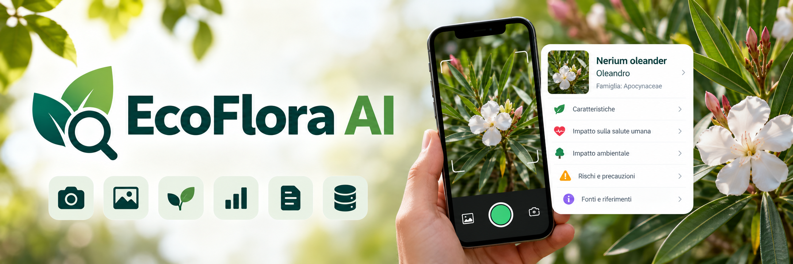

# EcoFlora AI — Web app per studenti e docenti

**Versione didattica 1.3 GitHub · HTML, CSS, JavaScript vanilla, IndexedDB, Font Awesome.**



> **Versione pubblica senza credenziali:** nessuna chiave Pl@ntNet è inclusa nel codice. Ogni studente inserisce la propria chiave dalle Impostazioni API.

EcoFlora AI consente di riconoscere piante a partire da fotografie (API Pl@ntNet), cercare nomi scientifici (GBIF), consultare brevi estratti enciclopedici (Wikipedia) e leggere schede qualitative sull'impatto delle specie sulla salute umana, sulla qualità dell'aria, sul clima e sulla biodiversità.

## Avvio rapido

1. Estrai questo archivio ZIP mantenendo la struttura delle cartelle.
2. Pubblica la cartella su un **hosting statico HTTPS** (ad esempio GitHub Pages o Netlify), oppure usa un server web locale per lo sviluppo. Con Python installato, il comando `python3 -m http.server 8080` avviato dentro la cartella è un *server per file statici*, non un backend dell'applicazione.
3. Apri `http://localhost:8080` in un browser aggiornato.
4. Usa **Esplora specie** per consultare le 9 schede di esempio o cercare altre specie su GBIF.
5. Usa **Riconosci una pianta**: premi **Apri fotocamera**, autorizza il permesso, inquadra la pianta e premi **Scatta foto**. In alternativa scegli **Carica dalla galleria**; se la ripresa live non è disponibile, usa **Fotocamera di sistema**. Premi poi **Analizza** per inviare un'immagine a Pl@ntNet. Prima dell'analisi, apri **Impostazioni API**, inserisci la **tua** chiave Pl@ntNet personale, salva e verifica la connessione. Nessuna chiave è distribuita insieme al progetto. Per richieste browser, abilita l'uso lato client (CORS) e autorizza il dominio sul portale Pl@ntNet.
6. Vai al **Laboratorio studenti** per creare o correggere una scheda, aggiungere i collegamenti alle fonti ed esportare/importare l'archivio di classe in JSON.

**Non avviare l'app come `file://` tramite doppio clic:** i moduli ES, le API e la PWA funzionano in modo affidabile da un'origine HTTP(S). Per la fotocamera di smartphone è generalmente richiesto HTTPS (localhost è un'eccezione di sviluppo).

### Fotocamera sul telefono

- Pubblica il sito su **HTTPS**, aprilo direttamente nel browser (Safari su iPhone/iPad, Chrome su Android) e concedi il permesso quando richiesto. `http://localhost` è consentito per sviluppo sullo stesso dispositivo; aprire da telefono un server `http://192.168.x.x:8080` non equivale a `localhost` e normalmente **non consente** la fotocamera live.
- Premi **Apri fotocamera** per l’anteprima live, poi **Scatta foto**. Il comando **Cambia fotocamera** prova a usare la camera frontale o posteriore, se il dispositivo la offre. **Chiudi** spegne le tracce della camera.
- Se il permesso è negato, il browser è incompatibile o manca HTTPS, compare **Fotocamera di sistema**: su molti telefoni apre l’app fotocamera tramite l’attributo HTML `capture="environment"`, ma il comportamento dipende dal browser. Il pulsante **Carica dalla galleria** resta sempre disponibile.
- L’app non trasmette video in diretta e non invia la foto a Pl@ntNet finché non premi **Analizza**. Navigando verso altre sezioni o nascondendo la pagina, la camera viene spenta.
- Dopo l’aggiornamento, se la vecchia PWA appare ancora, chiudi e riapri l’app o ricarica la pagina con Internet: il service worker è stato aggiornato alla cache `ecoflora-shell-v4`.

## Funzionalità

- Catalogo iniziale di 9 specie botaniche con schede qualitative e riferimenti.
- **Scatto diretto nell’app** con anteprima live (API `getUserMedia`), pulsante Scatta foto, scelta fotocamera anteriore/posteriore, chiusura dello stream; galleria e fotocamera nativa come alternative.
- Riconoscimento fotografico via Pl@ntNet con più risultati e confidenza probabilistica.
- Ricerca online GBIF, nomenclatura e famiglia; descrizioni e illustrazioni da Wikipedia quando disponibili.
- Preferiti e cronologia delle identificazioni confermate salvati in **IndexedDB**.
- **Nessuna chiave preconfigurata**: ogni studente inserisce la propria; è salvata in IndexedDB, può essere rimossa, e può verificare la raggiungibilità dell'API.
- Modulo per contributi degli studenti, con una fonte HTTPS distinta per ogni area di impatto compilata.
- Esportazione/importazione di schede, preferiti e cronologia in JSON, **senza esportare la chiave**.
- Scheda stampabile/esportabile in PDF tramite il comando di stampa del browser.
- PWA installabile; risorse HTML/JS/CSS di base memorizzate tramite Service Worker (i servizi online continuano a richiedere Internet).

## Configurazione personale della chiave Pl@ntNet

Questo archivio è pensato per essere condiviso su GitHub: **non contiene chiavi API**. La chiave personale viene inserita dall'utente in **Impostazioni API** e salvata nel solo IndexedDB del browser in uso. **Rimuovi chiave salvata** cancella tale impostazione locale; l'archivio JSON esportato non include le credenziali.

1. Accedi a <https://my.plantnet.org/> e crea una tua chiave API.
2. Nelle opzioni della chiave abilita l'esposizione per client browser (CORS) e autorizza l'origine in **Authorized domains**. Per un sito GitHub Pages standard è tipicamente `https://nomeutente.github.io` (sostituisci con l'origine effettiva), senza percorso di repository.
3. Apri **Impostazioni API**, incolla la chiave personale, premi **Salva chiave locale** e poi **Verifica connessione**. L'identificazione richiede inoltre una foto e può consumare quota.
4. Per cancellarla da quel browser, usa **Rimuovi chiave salvata**.

**Limite:** una web app solo client-side non può rendere segreta una chiave che deve trasmettere dal browser. IndexedDB non la pubblica sul repository, ma non è una cassaforte: chi usa quel dispositivo può leggere la propria chiave dagli strumenti del browser. Per una chiave centralizzata riservata servirebbe un proxy/server, che questa versione non richiede.

**Importante per il proprietario:** se la chiave precedente è stata condivisa in chat, in uno ZIP o su GitHub, **revocala/rigenerala da Pl@ntNet**, anche se non è più nei file del nuovo ZIP. Se era in vecchi commit Git, rimane potenzialmente recuperabile nella cronologia.

Pubblicazione passo-passo: [`docs/pubblicazione-github.md`](docs/pubblicazione-github.md). Nessuna richiesta reale è stata inviata usando la chiave originaria durante questa preparazione.

## API e servizi

| Servizio | Funzione | Credenziali |
|---|---|---|
| [Pl@ntNet](https://my.plantnet.org/doc/api/identify) | Riconoscimento fotografico AI | Chiave + impostazione CORS |
| [GBIF Species API](https://techdocs.gbif.org/en/openapi/v1/species) | Ricerca e risoluzione del nome scientifico | Nessuna |
| [MediaWiki Action API](https://www.mediawiki.org/wiki/API:Cross-site_requests) | Descrizioni e immagini da Wikipedia | Nessuna, query `origin=*` |
| IndexedDB | Preferiti, cronologia, schede studenti, modifiche API key | Nel browser |

**Nota:** GBIF e MediaWiki forniscono API pubbliche e dati aperti secondo le loro licenze; Pl@ntNet mette a disposizione un'API accessibile, ma il servizio AI non è necessariamente software open source. Font Awesome e i caratteri Google Fonts sono caricati tramite CDN, quindi richiedono rete al primo utilizzo.

## Dati scientifici, limiti e responsabilità

Le 9 schede di esempio sono **qualitative e non esaustive**. La classificazione di una specie non permette da sola di quantificare CO₂, temperatura o rimozione di PM, né di concludere che una pianta sia commestibile o innocua. Dove non ci sono dati documentati, l'app mostra *informazioni non verificate*. Le schede del laboratorio sono etichettate **contributi da verificare** finché un docente/esperto non le revisiona. In caso di ingestione sospetta di piante tossiche serve l'assistenza sanitaria, non questa app.

Wikipedia fornisce contenuti con attribuzione alla pagina originale. Prima di riutilizzare fotografie, verificare licenze e crediti degli autori dalla relativa pagina.

## Materiale per la classe

- [`docs/guida-studenti.md`](docs/guida-studenti.md): istruzioni pratiche, esercizi e criteri di qualità.
- [`docs/architettura.md`](docs/architettura.md): guida al codice, flussi, IndexedDB e punti da modificare.
- [`docs/api-e-sicurezza.md`](docs/api-e-sicurezza.md): endpoint, CORS, gestione della chiave, tutela dei dati.
- [`docs/test-e-rilascio.md`](docs/test-e-rilascio.md): prove manuali, pubblicazione e checklist per il docente.
- [`docs/pubblicazione-github.md`](docs/pubblicazione-github.md): istruzioni passo-passo per repository e GitHub Pages.

## File principali

```text
index.html                   Interfaccia e layout
css/style.css               Stile, responsive e stampa
js/app.js                   Vista, navigazione, laboratorio, logica principale
js/camera.js                Ripresa live, scatto, permessi e camera nativa di riserva
js/api.js                   Client delle API, elaborazione fotografie
js/data.js                  9 schede iniziali, con fonti e testi modificabili
js/config.js                Configurazione pubblica, chiave volutamente vuota
js/db.js                    IndexedDB (versione 2), lettura e scrittura
sw.js                       Service Worker per cache dell'interfaccia
manifest.webmanifest        Metadati PWA
assets/icon.svg             Icona
```

Licenza del codice originale del prototipo: MIT (vedi `LICENSE`). Le API, i contenuti scientifici e le immagini di terze parti hanno condizioni proprie.
